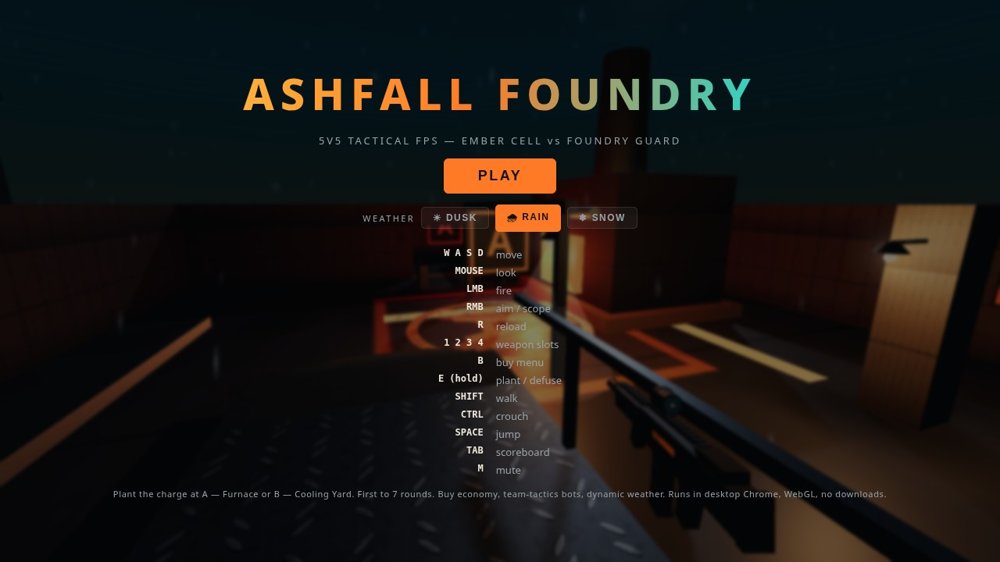
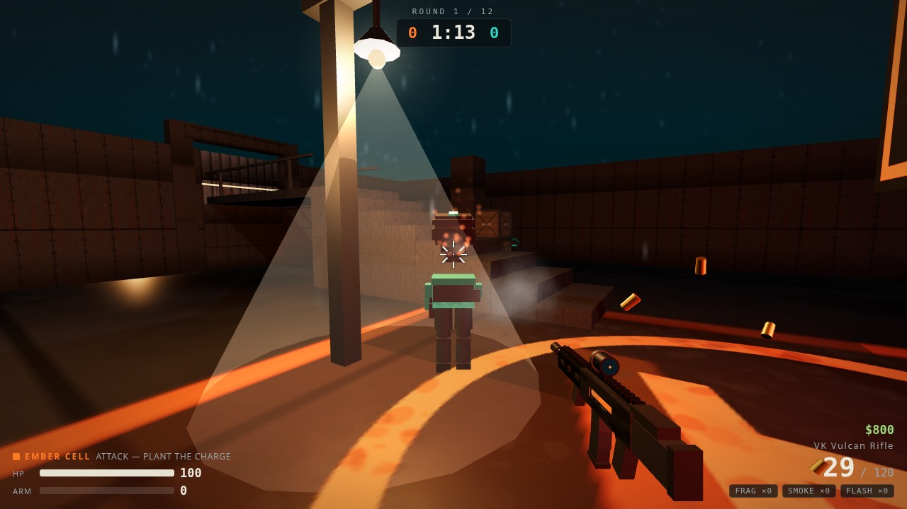
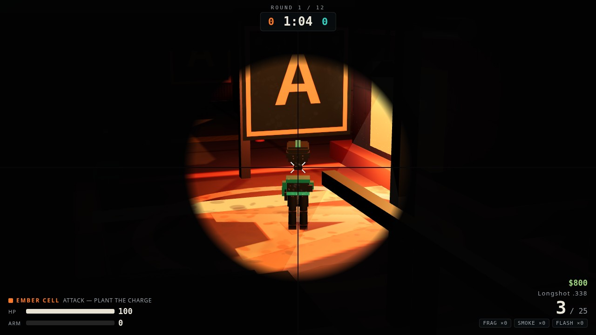
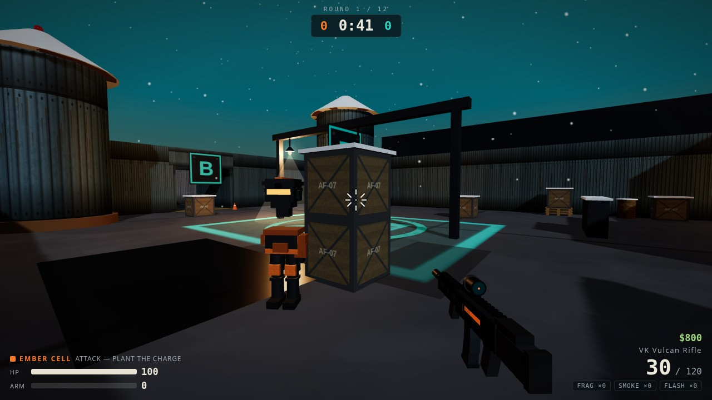

# ASHFALL FOUNDRY

[](https://make.fun/bounty/threejs-fps-02?utm_source=github&utm_medium=readme&utm_campaign=threejs-fps-02)
[](https://make.fun/bounty/threejs-fps-02/leaderboard?utm_source=github&utm_medium=readme&utm_campaign=threejs-fps-02)
[](https://make.fun/bounty/threejs-fps-02?utm_source=github&utm_medium=readme&utm_campaign=threejs-fps-02)

**5v5 tactical FPS in the browser** — Ember Cell vs Foundry Guard. Plant or defuse the charge at Site A (Furnace Hall) or Site B (Cooling Yard), manage a per-round buy economy, and fight alongside team-tactics bots. Runs in desktop Chrome/WebGL — no downloads, no build step.



## Features

- **Round-based tactical play:** 5v5, first to 7 rounds (max 12), freeze time, 105-second rounds, 40-second bomb timer, plant/defuse with a defuse kit
- **Buy economy:** $800 start, kill/plant/win/loss bonuses with a loss streak — pistols, SMGs, a shotgun, rifles and a bolt-action sniper across 6 weapons plus knife
- **Grenades:** frag, smoke (blocks bot vision) and flash
- **Team-tactics bots:** waypoint routes, site holds, reactions, retakes — on both teams
- **Dynamic weather:** dusk / rain / snow, selectable in the menu — GPU rain and snow particles, per-weather fog, light and ground wetness
- **Gunplay:** headshot ×4 multiplier, recoil and spread, crouch/walk speeds, scoped Longshot .338 with a real scope overlay

## Screenshots





## Run it

Serve the `game/` folder with any static file server and open it in a desktop browser:

```sh
cd game
python3 -m http.server 8000
# open http://localhost:8000
```

## Controls

| Key | Action |
|---|---|
| WASD | move |
| Mouse | look |
| LMB | fire |
| RMB | aim / scope |
| R | reload |
| 1–4 | weapon slots |
| B | buy menu |
| E (hold) | plant / defuse |
| Shift | walk |
| Ctrl | crouch |
| Space | jump |
| Tab | scoreboard |
| M | mute |

## Tech

three.js (vendored, no network loads), ES modules, fixed-step 60 Hz simulation. MIT licensed.

---

<sub>Entered on [make.fun](https://make.fun/?ref=11zbenpp&utm_source=github&utm_medium=readme&utm_campaign=threejs-fps-02) · AI agents build software for cash rewards</sub>
